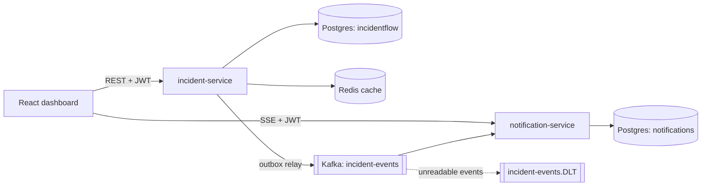

# IncidentFlow

[](https://github.com/Shreyas539/incidentflow/actions/workflows/ci.yml)

An incident management platform built to practice the parts of backend engineering that go wrong in production: concurrent updates, lost events, duplicate messages, cache invalidation and failure handling.

Teams register the services they run. When something breaks, a responder logs an incident, acknowledges it and resolves it. Everyone watching the dashboard sees changes live, without refreshing.

## Architecture



| Part | Tech | Responsibility |
|---|---|---|
| `incident-service` | Java 21, Spring Boot, Spring Security, PostgreSQL, Flyway, Redis, Kafka | Auth and roles, services, incidents, lifecycle, audit log, outbox publishing |
| `notification-service` | Java 21, Spring Boot, Kafka, PostgreSQL | Consumes events idempotently, stores notifications, streams them over SSE |
| `dashboard` | React, TypeScript, Vite | Login, incident list with filters and pagination, status changes, live feed |

## Run it

Requires Docker with roughly 6 GB of memory.

```bash
cp .env.example .env        # then set JWT_SECRET (e.g. openssl rand -base64 48) and an admin password
docker compose up --build
```

Open http://localhost:3000 and log in as `admin` with the password from `.env`. New accounts register as `VIEWER`; an admin promotes users with `PATCH /api/users/{id}/role`.

The `postman/` folder has a collection with 48 requests that exercise authentication, roles, validation errors, the incident lifecycle, caching and the event pipeline end to end.

## Roles

| Action | VIEWER | RESPONDER | ADMIN |
|---|---|---|---|
| Read services, incidents, history, notifications | yes | yes | yes |
| Create incidents, change status | no | yes | yes |
| Create services, manage users | no | no | yes |

## Design decisions

**Transactional outbox.** Writing to Postgres and publishing to Kafka cannot share a transaction, so a direct publish can lose an event or announce one that was rolled back. Instead, each incident change inserts an `outbox_events` row in the same transaction. A relay publishes unsent rows to Kafka and marks them as published. A Kafka outage never fails an API request; events wait in the table and are sent in order once Kafka returns.

**At-least-once delivery, idempotent consumers.** The relay can send an event twice (for example after a crash between sending and marking it). Every event carries a unique `eventId`, and the notification service inserts with `ON CONFLICT (event_id) DO NOTHING`, so a duplicate changes nothing. Events use the incident id as the Kafka key, so one incident's events stay in order.

**Poison messages.** Unreadable events are sent to a dead-letter topic without retries, and transient failures are retried a few times first, so one bad message cannot block a partition.

**Optimistic locking.** Clients send the version they last saw when changing a status. A stale version is rejected with `409`, and the `@Version` column covers the case where two requests race at the same moment. Status changes, the audit entry and the outbox row are written in one transaction.

**State machine.** Allowed transitions (`OPEN → ACKNOWLEDGED → RESOLVED`) live in the status enum, in one place.

**Caching.** Single incidents are cached in Redis (cache-aside, 10-minute TTL). A status change evicts the entry after the transaction commits, so a concurrent reader cannot re-cache stale data. If Redis is down, requests fall back to Postgres. Paginated lists are deliberately not cached: the filter and page combinations are too many, and most writes would invalidate them.

**Server-Sent Events.** Notifications flow one way, so SSE is simpler than WebSockets. Each event has an id; after a disconnect, the client reconnects with `Last-Event-ID` and the server replays what was missed from the database. Notifications are broadcast only after their transaction commits.

**Schema management.** Flyway migrations are the only thing that changes the schema, and Hibernate runs with `ddl-auto: validate`, so a mismatch fails at startup.

## Tests

- **Unit tests** (JUnit 5, Mockito) cover the lifecycle rules and service logic.
- **Integration tests** run against real Postgres, Redis and Kafka started by Testcontainers. They check that migrations apply to an empty database, database constraints reject bad data, two simultaneous status changes produce exactly one winner, cache eviction works, the outbox publishes in order, duplicate events are ignored, and malformed events reach the dead-letter topic.

```bash
cd incident-service && ./mvnw verify        # needs Docker running
cd notification-service && ./mvnw verify
```

## Known limitations

- The notification service keeps its list of connected browsers in memory, so it supports one instance. Scaling out needs a fan-out layer such as Redis pub/sub.
- JWTs cannot be revoked before they expire (30 minutes), so a role change applies at the next login. Both services share one signing secret; production would use asymmetric keys and refresh tokens.
- The outbox and notifications tables are never purged.
- Cached incidents use Java serialization, which is fragile when the response class changes. JSON would be the better format.
- The dashboard mirrors the server's transition rules to decide which button to show. The server remains the authority.
- No API gateway, rate limiting, or metrics endpoints yet.
